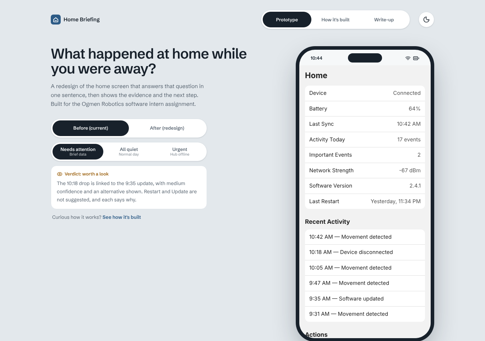
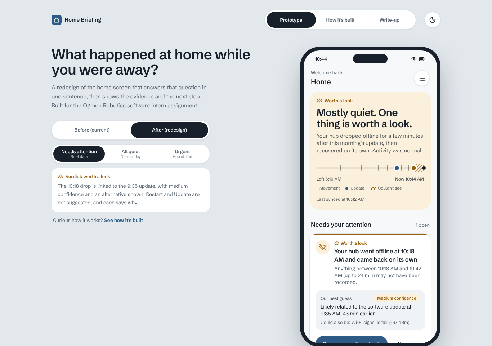
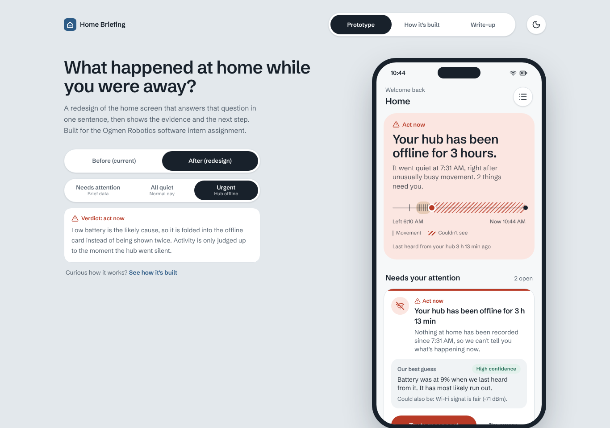

# Home Briefing

My submission for the Ogmen Robotics Software Intern Assignment 1 (2026), by Ashmit Sanjay Katale.

The assignment imagines someone opening a smart-home app after a few hours out and asking: *what happened while I was away, and is there anything I should care about?* The current screen has all the information, but every item carries the same weight, so it doesn't answer either question.

My redesign leads with the answer. One sentence says how things are, at most three cards say what needs you and what to do, and everything else (the raw numbers, the full event list) is still one tap away.

**Live demo:** _add the Vercel link here_

| Before | After | When something is wrong |
| --- | --- | --- |
|  |  |  |

## What to look at

The site has three pages:

- **Prototype**: the app screen in a phone frame. Flip between the current screen and the redesign, and between three scenarios.
- **How it's built**: every part of the brief mapped to what I built, a field-by-field table of where each old item went, an interactive walkthrough of the logic (live output plus the real source code), the rules and their numbers, the sample data, the stack and why I picked it, the design system and the tests.
- **Write-up**: assumptions, key decisions and what I'd do with more time.

[`DEMO_GUIDE.md`](./DEMO_GUIDE.md) is a one-page version for a live walkthrough.

## The redesigned screen

- **Verdict**: one sentence and a status (All clear, Worth a look, Act now), with a timeline of the time away. Gaps where the hub couldn't see anything are hatched.
- **Needs your attention**: up to three cards. Each says what happened, why it matters, my best guess at the cause and how confident I am, and one thing to do. "Why am I seeing this?" shows the events behind it and the rule that fired.
- **Everything else is fine**: the checks that passed, folded into one row.
- **While you were away**: movement grouped and compared with a normal day for this home, hour by hour.
- **Ask your home**: a few quick questions answered from the same data.
- **Device health**: plain words first ("Fair"), raw values next to them ("-67 dBm").
- **Controls**: every control says whether it's needed right now and why.

## Running it

You need Node 20 or newer.

```powershell
npm install
npm run dev       # local preview at http://localhost:5173
npm test          # tests for the rules engine
npm run build     # type check and production build into dist/
npm run lint
```

## How it works

There's no backend. The sample data lives in `src/data/scenarios.ts`, and all the decisions are made in `src/lib/triage.ts`, a set of plain functions with no React in them. The screen only draws what `buildBriefing()` returns, which kept the logic easy to test and to explain.

The steps, in order:

1. `groupActivity` groups the movement and compares it with the normal pattern for each hour.
2. `explainDisconnect` scores the possible causes of a disconnect and keeps the alternatives. `recoveredAt` works out whether the hub came back.
3. `buildFindings` gives each problem a score. 30 or more is worth a look, and 70 or more means act now.
4. `signalLabel` and `batteryDaysLeft` turn raw values into words.
5. `rankControls` decides which actions to suggest, with a reason for each.
6. `makeVerdict` writes the sentence at the top.

All the thresholds are in one `RULES` object. The "How it's built" page reads that object directly, so the numbers on the page always match the code.

### Project layout

- `src/data/scenarios.ts`: three scenarios on one schema (the brief's data, a quiet day, an urgent day)
- `src/lib/triage.ts`: the rules engine
- `src/lib/triage.test.ts`: 15 tests
- `src/components/BeforeScreen.tsx`: the current screen, recreated from the same data
- `src/components/briefing/`: the redesigned screen
- `src/components/build/`: the "How it's built" page
- `src/components/ui/`: restyled shadcn/ui components
- `src/content/writeup.ts`: the write-up text

### Stack

Vite, React 19 and TypeScript, Tailwind CSS 4, shadcn/ui on Radix, lucide-react icons, Sonner toasts, Schibsted Grotesk (self-hosted), Vitest, oxlint and Prettier. The reasons for each, and for what I left out, are on the "How it's built" page.

## Deploying

It builds to static files, so any static host works. On Vercel, import the repository and keep the detected Vite settings: build command `npm run build`, output folder `dist`.
